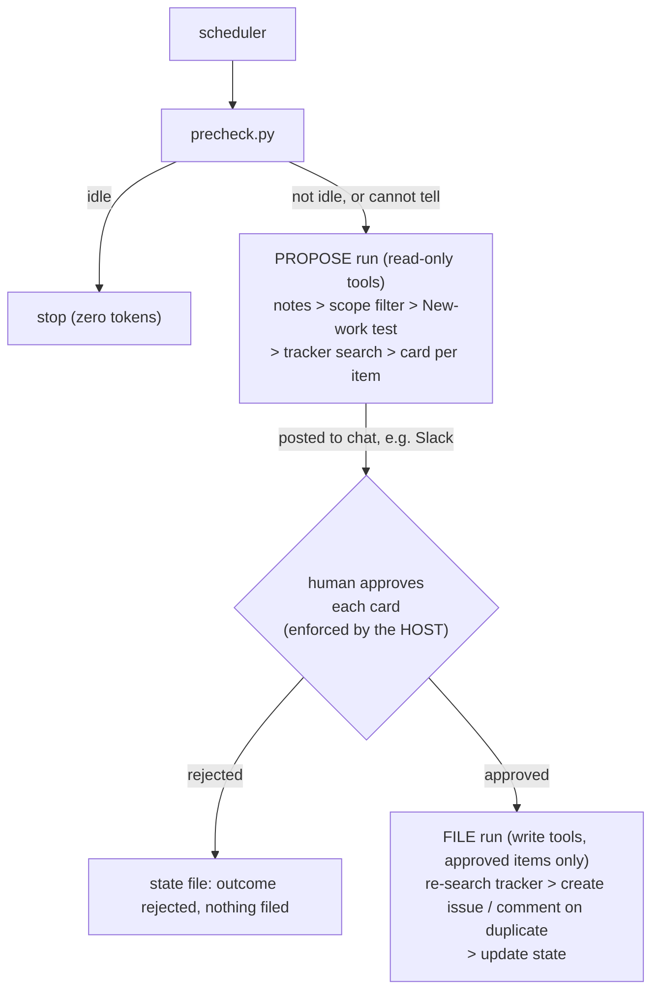

# skills

At [Storra](https://getstorra.com) we run a lot of agent skills internally. Most are tied to our own repos, tools and
processes. The ones here are those we have chosen to make public: generic enough to be useful elsewhere, and written so
they can be installed as-is.

Each skill follows the [Agent Skills](https://agentskills.io) layout and is self-contained in its own folder under
`skills/`.

| Skill | What it does | Runs in |
|---|---|---|
| [Actions to Issues](#actions-to-issues) | Turns new meeting notes into tracker issues, with a human approval for every issue | [OpenClaw](https://docs.openclaw.ai), Claude Code |

Contributing: see [CONTRIBUTING.md](CONTRIBUTING.md) (rules, tests, hooks, Tessl review and evals).

## Actions to Issues

`skills/actions-to-issues/` turns new meeting notes (**Granola**, **Fireflies** or **Fathom**) into tracker issues
(**Linear**, **Jira** or **GitHub Issues**), with **a human approval for every issue**. It is a skill (instructions plus
a pre-check script), not a service. See [Compatibility](#compatibility) for what is supported and how far each
integration has been tested.

> **Read before installing.** It reads text other people wrote (transcripts) and can write to a shared tracker, so
> prompt injection is the main risk. The skill states an approval rule; **it cannot enforce it.** Whether a human
> approval really gates tracker writes depends on your host. See [Is the approval enforced?](#is-the-approval-enforced).

### What it does

- Finds meetings not yet handled, with a zero-token pre-check so an idle day costs almost nothing.
- Filters to company business, then applies a **New-work test** (new, decided, durable): a standup usually yields no
  issues.
- Proposes each item as its own **approval card**: title, source, verbatim quote, tracker search result, and the
  project, labels, priority and assignee it would use.
- After a human approves, re-searches the tracker, then files the issue or comments on an existing one.
- Records what it handled in a state file, so nothing is proposed twice.

Two phases with two tool sets is the core design: PROPOSE needs read-only access, and only FILE needs tracker write
tools, started only after the host has recorded an approval.

### Requirements

| Need | Detail |
|---|---|
| Notetaker | One supported note source with its MCP server connected to your agent host (see [Compatibility](#compatibility)) |
| Tracker | One supported tracker with its MCP server connected |
| Approvals | A chat surface for cards (built around Slack) and a way for a human to approve |
| Python | 3.9+ for the pre-check, standard library only |

### Compatibility

Set `source:` and `tracker:` in the config; leaving either out keeps the original Granola and Linear behaviour. Each
integration is one file in `references/` (`source-<name>.md`, `tracker-<name>.md`), loaded only when configured. Docs
read on 24 November 2026; check them against your account.

**Note sources**

| Source | Route | Zero-token pre-check | Verified |
|---|---|---|---|
| Granola (default) | MCP `https://mcp.granola.ai/mcp`, OAuth ([docs](https://docs.granola.ai/help-center/sharing/integrations/mcp)) | Yes, over MCP with the agent's token | In use; pre-check also tested against a local fake |
| Fireflies.ai | MCP `https://api.fireflies.ai/mcp`, OAuth or API key ([docs](https://docs.fireflies.ai/getting-started/mcp-configuration)) | Yes, GraphQL with `FIREFLIES_API_KEY` | Docs only; pre-check tested against a local fake |
| Fathom | MCP `https://api.fathom.ai/mcp` ([docs](https://developers.fathom.ai/mcp-docs/claude.md)); tool names undocumented, so you name them in `fathom.tools` | Yes, REST with `FATHOM_API_KEY` ([docs](https://developers.fathom.ai/api-reference/meetings/list-meetings)) | Docs only; pre-check tested against a local fake |

Not supported yet: Otter, Read.ai and Zoom AI Companion (no official route we could confirm); tl;dv, Notion AI
meeting notes and Google Meet notes (possible, not built).

**Trackers**

| Tracker | MCP server | Card fields | Verified |
|---|---|---|---|
| Linear (default) | `https://mcp.linear.app/mcp` ([docs](https://linear.app/docs/mcp)) | Project, labels, priority, assignee | Tool names checked against the live server; filing path unchanged |
| Jira | Atlassian Rovo MCP `https://mcp.atlassian.com/v2/mcp` ([docs](https://support.atlassian.com/atlassian-rovo-mcp-server/docs/supported-tools/)) | Project, issue type, components, labels, priority, assignee | Docs only |
| GitHub Issues | GitHub MCP `https://api.githubcopilot.com/mcp/x/issues` ([docs](https://github.com/github/github-mcp-server)) | Repository, labels, milestone, assignees (no priority field) | Tool names checked live, read-only; nothing filed |

Each reference file lists that integration's read tools (PROPOSE) and write tools (FILE), so the host can allow one set
and gate the other. On GitHub, labels and assignees are dropped unless the filing account has write access, and issues
on a public repo are world-readable: set `issue.source_links: false` to keep meeting links out of them.

### Install

| Host | How |
|---|---|
| Claude Code | Copy `skills/actions-to-issues` into `.claude/skills/` or `~/.claude/skills/`; keep tracker write tools on **ask** or **deny**. See [`docs/claude-code.md`](docs/claude-code.md) |
| OpenClaw | `openclaw skills install @<publisher>/actions-to-issues` once published, or copy the folder into `<workspace>/skills/`. See [`docs/openclaw.md`](docs/openclaw.md) |

Installing does **not** configure approvals.

### Configure

1. Copy [`assets/config.example.yaml`](skills/actions-to-issues/assets/config.example.yaml) somewhere private and fill it in:
   `source:`, `tracker:`, the tracker's allowed projects (or repos), labels and people (with ids), company email
   domains, caps. The skill invents none of these.
2. Set the environment:

   | Variable | Required | Meaning |
   |---|---|---|
   | `MN2L_CONFIG` | yes | Path to your config |
   | `MN2L_STATE` | yes | Path of the state file (created on first run) |
   | `MN2L_SOURCE` | for the pre-check | Note source, matching `source:` (default `granola`) |
   | `GRANOLA_ACCESS_TOKEN` or `MCP_AUTH_FILE` | pre-check, Granola | Bearer token, or a JSON auth file. No default path |
   | `FIREFLIES_API_KEY` / `FATHOM_API_KEY` | pre-check, Fireflies / Fathom | API key for that source |

3. Run the [pre-check](docs/precheck.md) from your scheduler and start the agent unless it exits `0`.

### Is the approval enforced?

| Setup | Enforced? |
|---|---|
| **Reference pattern**: a dispatcher outside the model starts it without tracker write tools, starts a separate run with them only after an approval store records a decision, then audits | **Yes.** The model never holds the tool |
| OpenClaw, skill installed, nothing else | **No.** A prompt rule |
| OpenClaw with the tool split and authorised-approver setup in [`docs/openclaw.md`](docs/openclaw.md) | **Partly.** Not verified on a live install |
| OpenClaw plus a `before_tool_call` plugin using `requireApproval` | **Yes, per call**, if it can match the tracker's write tools (docs do not confirm) |
| Claude Code, tracker write tools on `ask` ([permissions](https://code.claude.com/docs/en/permissions)) | **Yes, interactively.** Headless, an unanswered `ask` is not an approval |
| Anything else | Assume a prompt rule until tested |

**Test it:** in the PROPOSE setup, ask the agent to create an issue in your tracker. If it can, you have no gate.

### Threat model

- **Untrusted input.** Anyone quoted in a transcribed meeting can try to instruct the model. The skill treats meeting
  text as data; that is a mitigation, not a defence. Design so the worst case is a rejected card.
- **The gate is the host's job.** See the table above.
- **The approver is attack surface.** Cards quote meeting text verbatim.
- **Data exposure.** The notetaker account may see a whole calendar; the scope filter is also a prompt rule.

Full version and hardening steps: [`docs/threat-model.md`](docs/threat-model.md).

### Layout

| Path | What |
|---|---|
| `skills/actions-to-issues/` | The skill; copy this folder as-is |
| `skills/actions-to-issues/SKILL.md`, `assets/`, `references/` | Instructions, config template, policy, formats, one file per source and tracker |
| `skills/actions-to-issues/scripts/` | Zero-token pre-check (`precheck.py`) with one module per source |
| `docs/` | Threat model, pre-check, OpenClaw and Claude Code notes |
| `tests/` | Unit and loopback tests, synthetic data only |

### Related projects

Licences and activity as seen on GitHub on 18 November 2026; check before relying on them.

| Project | What it is | Difference |
|---|---|---|
| [OneWave-AI/claude-skills](https://github.com/OneWave-AI/claude-skills) `meeting-to-tasks` (MIT) | Claude Code skill: transcript to action items and Linear / GitHub task files | Captures more and flags low confidence; this skill files less, reads the notetaker directly, and gates every issue on an approval |
| [franzvill/action-sync](https://github.com/franzvill/action-sync) (MIT) | App: transcript to Jira tickets, with repo context | Pasted transcripts rather than a notetaker; last pushed March 2026 |
| [Granola MCP](https://docs.granola.ai/help-center/sharing/integrations/mcp) | The default server this skill reads from | Not replaced by this skill |

### Provenance

- Derived from an internal meeting-triage assistant; only the generic policy and pre-check came across (no deployment
  machinery, tracker data or real meeting content).
- OpenClaw statements are from its public docs as read on 9 October 2026 ([`docs/openclaw.md`](docs/openclaw.md)); verify
  them against your install.

## Acknowledgements

- The [Agent Skills](https://agentskills.io) format ([spec](https://github.com/agentskills/agentskills), Apache-2.0).
- [OpenClaw](https://docs.openclaw.ai) and ClawHub.
- [Granola](https://www.granola.ai), [Fireflies.ai](https://fireflies.ai), [Fathom](https://www.fathom.ai),
  [Linear](https://linear.app), [Jira](https://www.atlassian.com/software/jira) and [GitHub](https://github.com). Not
  affiliated with or endorsed by any of them.

## Licence

MIT, see [`LICENSE`](LICENSE).
